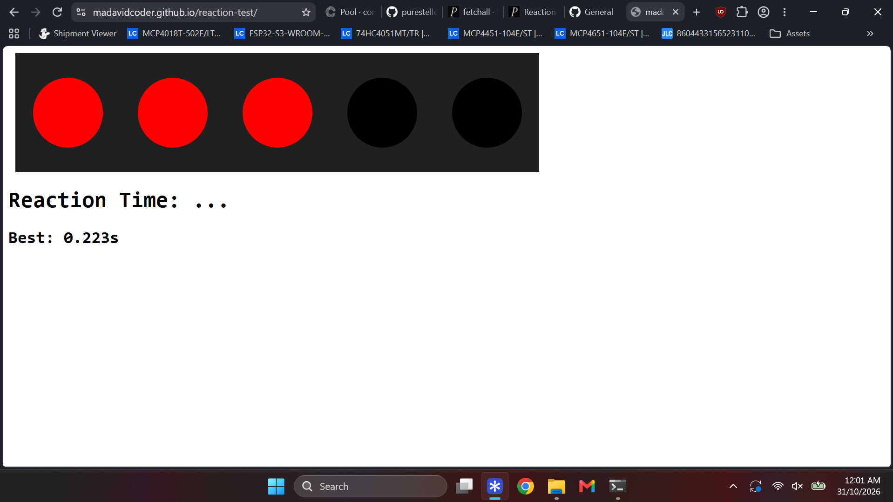

# Reaction Time Tester

### [https://madavidcoder.github.io/reaction-test/](https://madavidcoder.github.io/reaction-test/)

This is a fun little website I whipped up in a couple hours, because I was bored on a flight :D

It's a reaction time tester, designed in the style of the F1 start lights. So each light will turn on one by one, and then after a random amount of time, they all turn off, and you have to click the spacebar as quickly as you can.

I kept this as a pretty simple tech stack, given the minimal scope, so ts just html, js, and css. No fancy Typescript or anything, because, frankly, there's no need for them in such a small project.

Because I was on a plane, I didn't have documentation around, and ironically the main problem I had was that I could not remember how on earth to get random numbers in javascript 😭

So, not wanting to admit defeat, I came up with a mildly cooked way of creating a pseudo-random number, enough that it _seemed_ random to the user. I used the current time seed to calculate the seconds. Of course this is in now way at all random, nor at all secure, but sometimes strange solutions work well enough lol

`(Date.now() % 5000) + 2000`

And then while I was at it, because scope creep is real, I also added a personal best score, which stores in the browsers local storage.

Overall this certainly wasn't the most unique project, nor was it particularly well coded... But it was a bit of fun, and I was pleased that I got it working without using any AI, Google, or Documentation, because I had no internet on the plane. It was in many ways a really great experience to remember how I once coded (before I started taking the easy route of turning to Google or AI with bugs and errors), by just testing things and trying things that I half remembered until they somehow worked well enough. For example, I kinda forgot how to make circles and how to align things to begin with, and I just messed around with the CSS until it worked, which was a very refreshing reminder.
